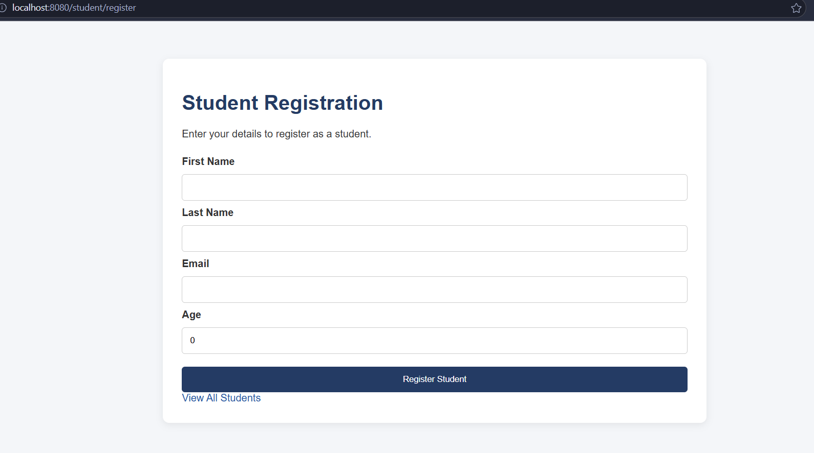
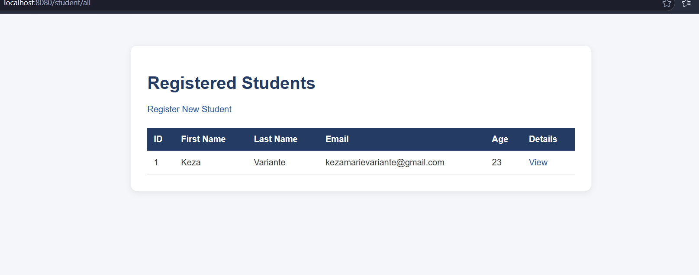
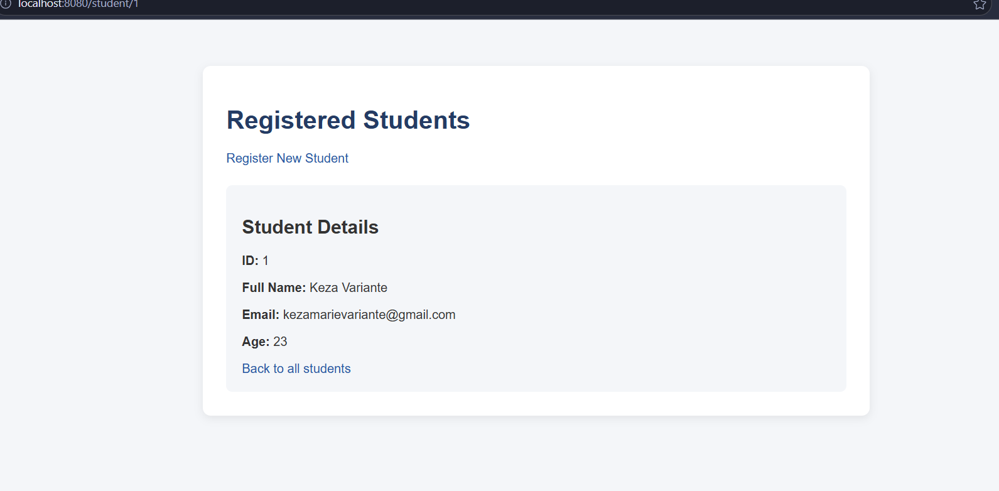
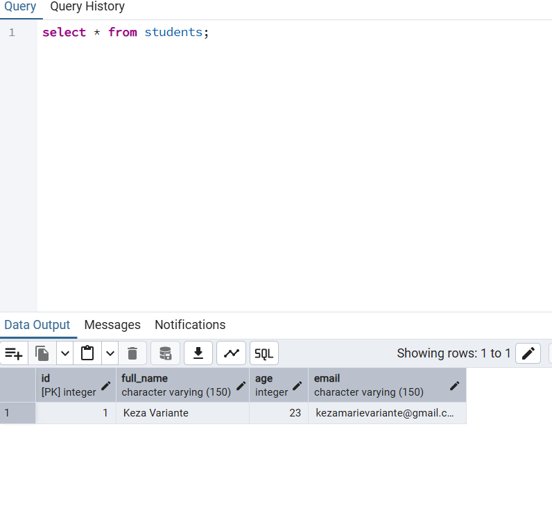

# Student Registration and Management System

## Project Description

A web-based Student Registration and Management System developed using Spring MVC, Thymeleaf, Java, and PostgreSQL.

The application allows users to register students, save their information in a PostgreSQL database, view all registered students, and retrieve an individual student using their ID.

## Technologies Used

- Java
- Spring Boot
- Spring MVC
- Thymeleaf
- PostgreSQL
- JDBC
- HTML and CSS
- Maven
- IntelliJ IDEA

## Project Structure

- model: Contains the Student class.
- controller: Handles HTTP requests and returns views.
- service: Contains application business logic.
- repository: Handles database operations using JDBC.
- resources/templates: Contains Thymeleaf HTML pages.
- resources/static: Contains CSS styling.

## Database Setup

Create a PostgreSQL database named student_management.

Executed the following SQL:

    CREATE TABLE students (
        id SERIAL PRIMARY KEY,
        full_name VARCHAR(150) NOT NULL,
        age INTEGER CHECK (age > 18),
        email VARCHAR(150) UNIQUE NOT NULL
    );

Configured the following environment variables:

- DB_URL
- DB_USERNAME
- DB_PASSWORD

## Running the Application

1. Clone the GitHub repository.
2. Open the project in IntelliJ IDEA.
3. Configure the database and environment variables.
4. Reload Maven dependencies.
5. Run StudentManagementApplication.java.
6. Open http://localhost:8080/student/register.

## Spring IoC and Dependency Injection

Spring IoC (Inversion of Control) is a principle where Spring manages the creation and lifecycle of application objects.

The application uses Spring-managed beans through @Controller, @Service, and @Repository.

Constructor-based Dependency Injection is used to connect the application layers.

StudentController depends on StudentService, while StudentService depends on StudentRepository.

Spring automatically creates these objects and injects their dependencies through constructors.

This avoids manually creating objects using the new keyword.

## Controller Handler Mappings

The StudentController handles the following requests:

- GET /student/register: Displays the registration form.
- POST /student/register: Receives and saves student information.
- GET /student/all: Displays all registered students.
- GET /student/{id}: Displays a specific student using their ID.

The controller uses @GetMapping, @PostMapping, @RequestMapping, @ModelAttribute, and @PathVariable.

## JDBC Database Operations

The StudentRepository uses manually written SQL queries.

Connection establishes communication with PostgreSQL.

PreparedStatement executes parameterized SQL queries.

ResultSet retrieves records from the database.

The INSERT query combines firstName and lastName into full_name before saving.

The SELECT query retrieves all registered students or a specific student by ID.

## Screenshots

### Student Registration Page

### Student List Page

### Search Student BY ID

### PostgreSQL Database Records

